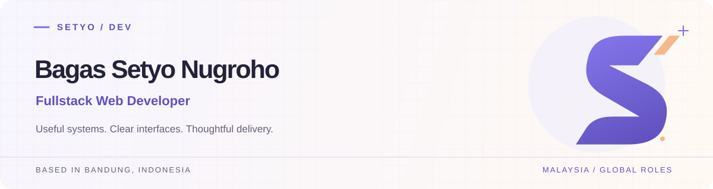

  

# Bagas Setyo Nugroho

**Fullstack Web Developer** · Bandung, Indonesia

I build and maintain web applications for government services, enterprise workflows, and internal business teams. I work across frontend interfaces, backend services, and API integration, taking features from understanding requirements through implementation and ongoing maintenance.

> I'm interested in fullstack opportunities in **Malaysia and with international teams**. Open to discussing relocation or remote work.

## Work highlights

- **APPWARD:** developing and maintaining a Laravel application used for business operations.
- **Hubla platform & services:** developing public-facing pages, service workflows, and administrative interfaces with .NET and Angular.
- **Citizenship application:** rebuilding an existing Yii2 system with NestJS and Next.js.
- **DPD RI portal:** implementing interfaces and integrating APIs with Tailwind CSS, Alpine.js, and .NET Core.

These are client projects, so their code is not public. I'm happy to discuss my work and the decisions behind it.

## Stack

- **Languages:** PHP, JavaScript, Go
- **Backend:** Laravel, Yii2, .NET, Express.js, NestJS, Bun
- **Frontend:** React, Next.js, Vue, Nuxt.js, Angular, Tailwind CSS, Alpine.js
- **Data & tools:** MySQL, PostgreSQL, SQLite, Git, Docker, MinIO
- **AI & Automation:** n8n, RAG, 9Router

I like to understand the workflow and constraints first, then build in manageable steps and improve the details with feedback.

I graduated in Informatics Engineering from Universitas Sangga Buana in October 2026, completing my degree while working professionally.

## Connect

[Portfolio](https://setyo.dev) · [LinkedIn](https://www.linkedin.com/in/bagas-setyo) · [Email me](mailto:bagazfrazetyo@gmail.com)
